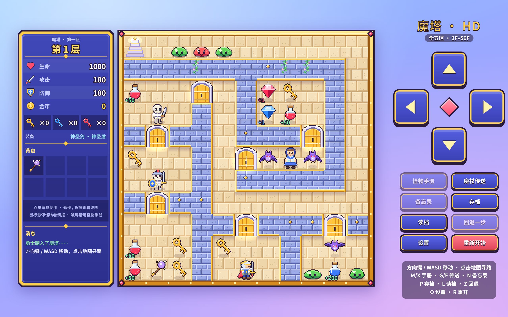

# 魔塔 50 层 · 高清重绘版

小时候玩过的那个经典 50 层魔塔，我把它从头重画了一遍。

地图、怪物、数值、剧情和隐藏要素都尽量照着原版来，数据主要参考 H5 魔塔广场上的 50（51） 层塔。美术全部重新画成了高清像素风，音乐和音效是用浏览器实时合成的。另外加了一些 H5 版常见的方便功能，比如存读档、回退、自动拾取，不想用的都可以关掉。浏览器里直接能玩，电脑和平板都可以。



## 下载与部署

先从 GitHub 克隆：

```bash
git clone https://github.com/tuichuyiban/magic-tower-50-hd.git
cd magic-tower-50-hd
```

或者直接下载压缩包解压。

电脑上需要先装好 [Node.js](https://nodejs.org/)（18 以上，建议 20 以上），然后在项目目录里运行：

```bash
npm install
npm run dev
```

终端里会显示一个地址，用浏览器打开就能玩。平板和电脑连同一个 Wi-Fi 的话，用平板打开终端里 Network 那一行的地址就行，横屏玩最舒服。

想放到自己的网站或服务器上，运行 `npm run build`，生成的 `dist` 文件夹是纯静态文件，放到任何静态托管上都能用。

**Windows（PowerShell）**：多条命令要用 `;` 连接，不要用 `&&`，比如 `npm install; npm run dev`。如果提示脚本被禁止运行，把 `npm` 换成 `npm.cmd`。

**安卓（Termux）**：先 `pkg install nodejs`，再运行 `termux-setup-storage` 允许访问存储，把下载好的文件夹从 Download 复制过来（具体地址以你下载为准）：

```bash
cp -r ~/storage/downloads/magic-tower-50-hd ~/
cd ~/magic-tower-50-hd
npm install
npm run dev
```

然后用手机或平板的浏览器打开 `http://localhost:xxxx`。

## 游戏玩法

勇士要一路往上爬到 50 层，救出公主，打败魔王。

**战斗**是自动结算的：勇士先出手，每回合造成「攻击 − 怪物防御」的伤害，怪物每回合回敬「怪物攻击 − 勇士防御」。打不动的怪碰不了，打不过的会提示，不会让你白白送命。拿到怪物手册后，地图上会直接标出每只怪要扣多少血。

**钥匙和门**：黄、蓝、红三种门各用对应颜色的钥匙，钥匙很珍贵，开哪扇门要想清楚。

**道具**：血瓶回血，红宝石加攻击，蓝宝石加防御，越往上数值越高。一路上还能拿到剑和盾，以及镐、炸弹、冰魔法、楼层飞行器这类特殊道具，拿到后放在背包里，点一下就能用。

**商店和祭坛**：商人卖钥匙，祭坛可以花金币换生命、攻击或防御，每次买完都会涨价。金币怎么花，基本就决定了后面能不能打得过去。

### 操作

- **触屏 / 鼠标**：用右侧方向键走，或者直接点地图上的格子自动走过去。点怪物、门或道具，会走到旁边直接打、开门或拾取。
- **键盘**：方向键或 WASD 移动，按住可以连续走。

| 按键 | 功能 |
| --- | --- |
| M / X | 怪物手册 |
| G / F | 楼层传送 |
| N | 备忘录 |
| P | 存档 |
| L | 读档 |
| Z | 回退一步 |
| O | 设置 |
| R | 重新开始 |
| 1–8 | 使用对应的特殊道具 |
| Esc | 关闭弹窗 |

### 一些额外功能

- **自动拾取 / 自动清怪 / 自动开暗墙**：在设置里开，默认都关着。自动清怪只打不掉血的怪，跟剧情有关的怪一律不碰。
- **楼层传送**：开局就有魔杖，站在楼梯旁可以飞到去过的楼层。
- **回退一步**：手滑了可以撤回上一个操作，比如开门、打怪、捡东西。
- **存档**：一共 400 个存档位，每个都带地图缩略图，另外每次换层还会自动存一次。
- **开局选项**：可以选择打开 36 层的暗道和 48 层隐藏的魔法警卫，这两处是更早期版本里的内容，开了会稍微简单一点。
- **试玩模式**：开始画面可以选，直接从第 11、21、31、41 层开始，属性给得很足，适合想直接看后面剧情的人。试玩模式的存档跟正式存档分开保存。
- **武器特效**：换了更好的剑，攻击特效也会跟着变华丽。

如果后续有空，并且大家玩下来体验不错的话，我会继续做 24 层魔塔的重绘。

若想体验更多魔塔玩法，可以登录魔塔广场进行体验（https://h5mota.com/）
